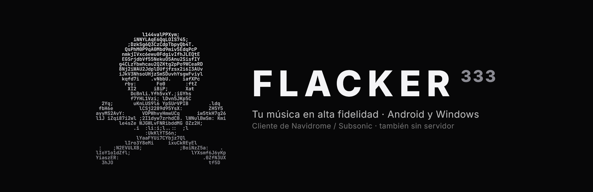
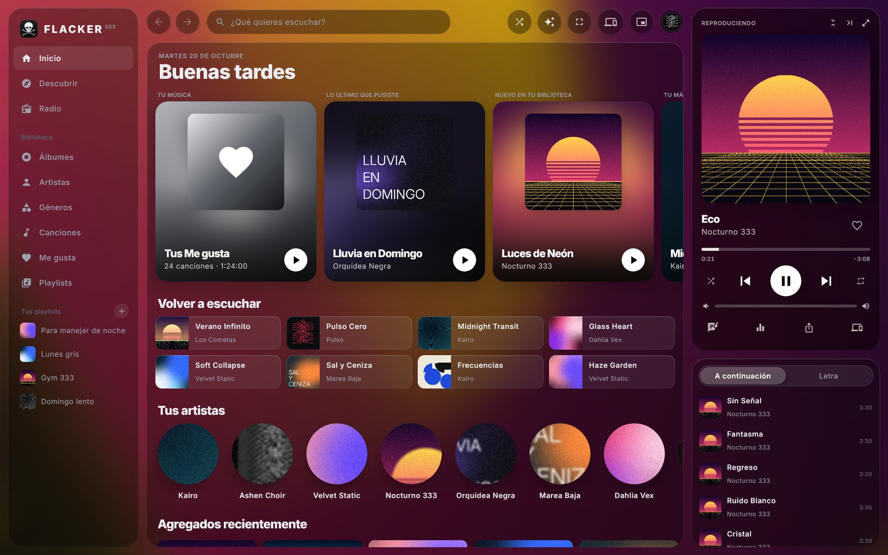
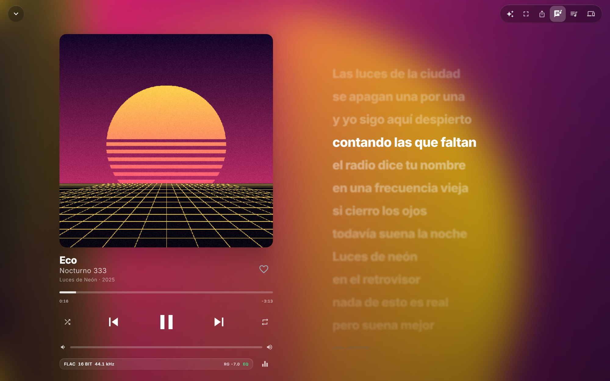
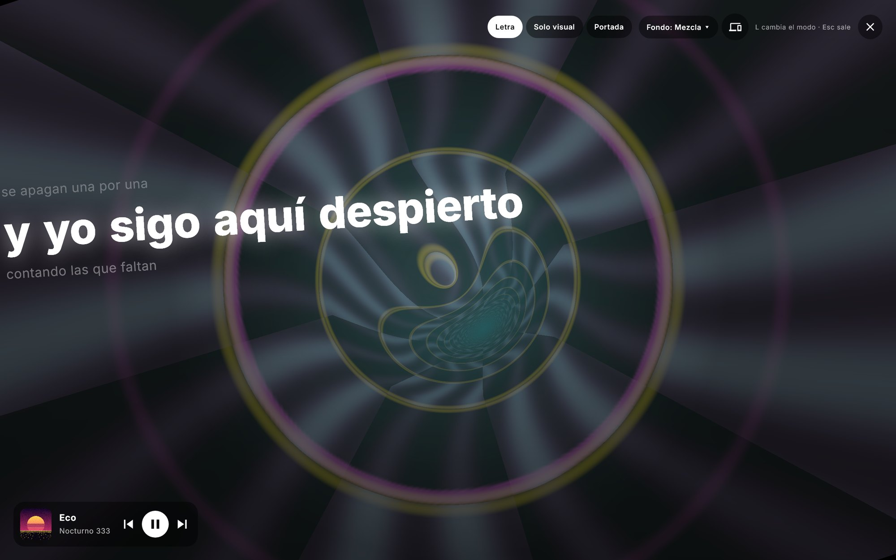
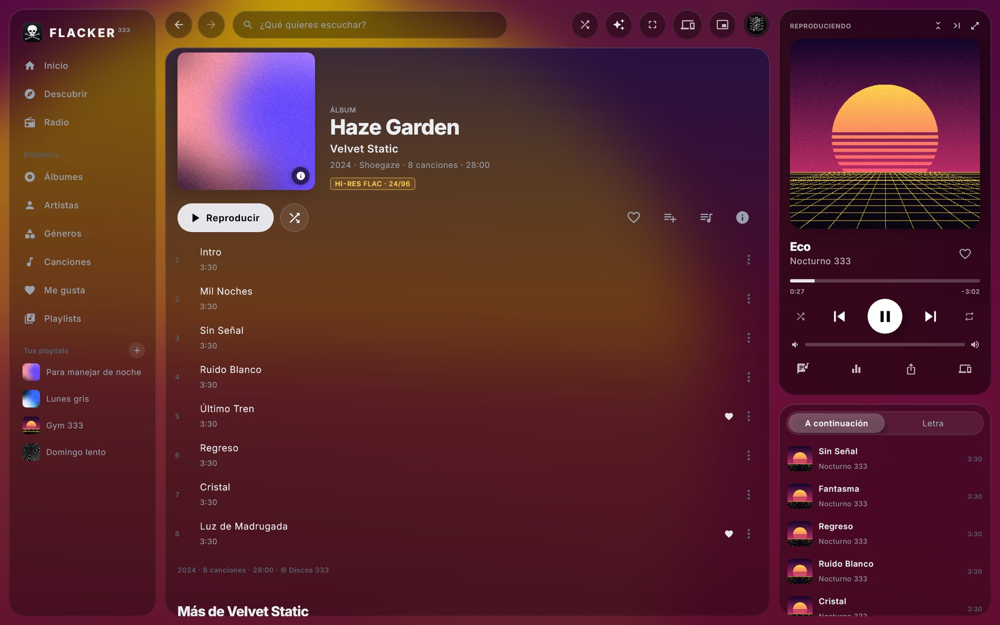
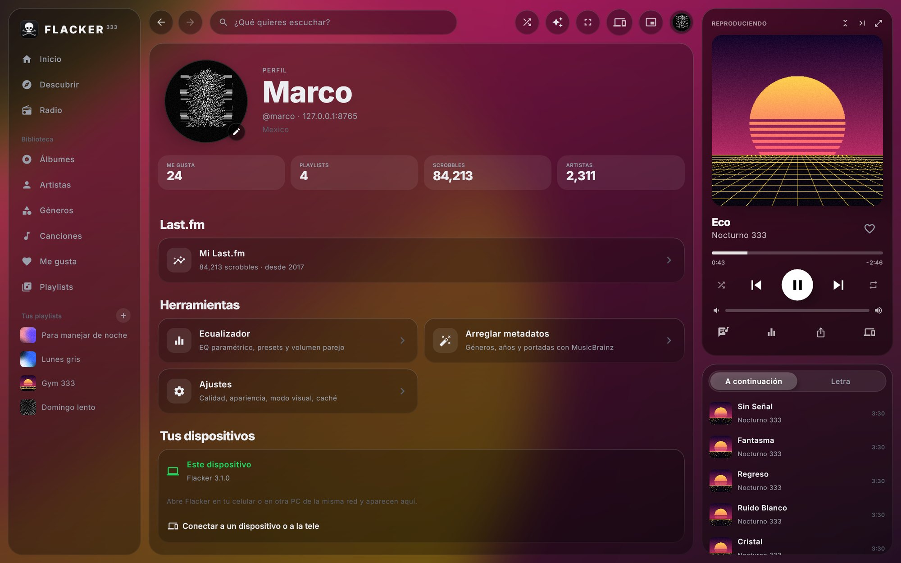
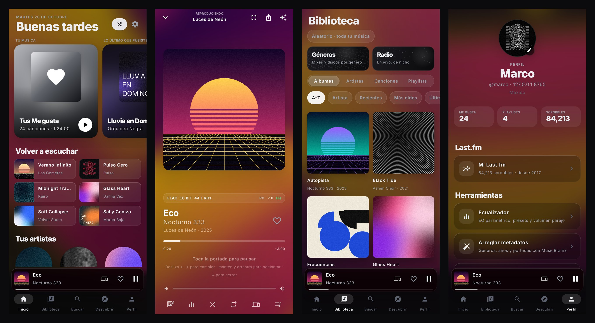
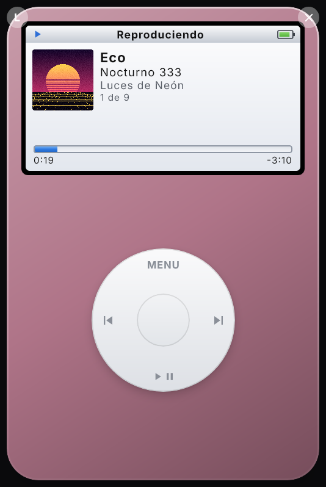

<p align="center">
  
</p>

<p align="center">
  <a href="https://github.com/Mapka21/flacker/releases/latest/download/Flacker.apk"></a>
  <a href="https://github.com/Mapka21/flacker/releases/latest/download/Flacker-Windows.zip"></a>
  <a href="https://github.com/Mapka21/flacker/releases/latest"></a>
  <a href="LICENSE"></a>
</p>

**Flacker** es un reproductor de música hi-fi para **Android y Windows** con cara de app de un millón de dólares.
Se conecta a tu servidor **Navidrome / Subsonic**, o toca los archivos de tu celular o de una carpeta de tu PC
sin ningún servidor. El mismo código y el mismo diseño en los dos.

<p align="center">
  
</p>

## Descargar

| | |
|---|---|
| **Android** (8.0 o más nuevo) | Baja [`Flacker.apk`](https://github.com/Mapka21/flacker/releases/latest/download/Flacker.apk), ábrelo y deja que Android instale apps de "origen desconocido". |
| **Windows** (10 / 11, 64 bits) | Baja [`Flacker-Windows.zip`](https://github.com/Mapka21/flacker/releases/latest/download/Flacker-Windows.zip), descomprímelo donde quieras y abre `Flacker\Flacker.exe`. Java y ffmpeg ya vienen adentro. |

Al abrirla pon la URL de tu Navidrome, tu usuario y tu contraseña. ¿No tienes servidor? Toca **"Usar la
música de este celular"** (o en la PC **"Usar mi música de una carpeta"**) y todo lo demás funciona igual.
Para escuchar tu servidor fuera de casa, tiene que estar en internet (dominio con HTTPS o reverse proxy) o en
una VPN como Tailscale.

## Qué trae

<p align="center">
  
  
</p>

- **Sonido**: FLAC, ALAC, Opus y hi-res de 24 bits (DSD en la PC) con **gapless** de verdad. Trae un **EQ paramétrico
  de 10 bandas** con presets y A/B, ReplayGain, volumen parejo entre canciones y medidores de estudio (VU,
  espectro, goniómetro).
- **Diseño**: el fondo se mueve con los colores de la portada y los paneles son de vidrio. La letra va
  sincronizada como en Apple Music y todo se anima con resortes.
- **Modo visual y pantalla completa**: el fondo se vuelve visualizador. Hay un **Neón 360** inspirado en el
  visualizador de la Xbox 360 de Jeff Minter, además de Nexo, Hiperespacio, Halo, ASCII 333 y más, con la
  letra encima. En la PC va a 60 fps.
- **Como Spotify**: "Iniciar radio" desde cualquier canción, populares del artista, **Descubrir** música nueva
  a partir de lo que te gusta, radio por internet de nicho, Géneros (corregidos con MusicBrainz), playlists
  con portada propia y scrobbling a **Last.fm** con tu panel de estadísticas dentro de la app.
- **Connect**: tu celular y tu PC se ven en la misma red y la música brinca de uno a otro sin cortarse. También
  transmite a la **tele**: Chromecast, Roku y DLNA (Samsung, LG…).
- **PC de verdad**: barra de título propia, controles en la vista previa de la barra de tareas, el panel
  multimedia de Windows, teclas multimedia, atajos como Spotify, clic derecho en todo y un **miniplayer iPod
  nano** que siempre queda encima.
- **Celular**: descargas para escuchar sin conexión, caché, calidad distinta para Wi-Fi y datos, controles
  por gestos e historias para Instagram con la portada o la letra.
- **Arreglar metadatos** (PC): completa géneros, años y portadas con MusicBrainz. Hazlo en una copia la primera vez.

<p align="center">
  
  
</p>

<p align="center">
  
</p>

<p align="center">
  
</p>

Lo que cambió en cada versión está en el [historial de cambios](CHANGELOG.md).

> Las capturas usan una biblioteca de muestra con artistas y portadas inventados
> (`tools/fake-navidrome/showcase.py`).

## Atajos en Windows

**Espacio** reproduce o pausa (menos mientras escribes). **Ctrl+→ / Ctrl+←** cambian de canción y
**Ctrl+↑ / Ctrl+↓** suben o bajan el volumen. **Alt+← / Alt+→** y los botones laterales del mouse van
atrás y adelante. **F11** abre la pantalla completa. La rueda del mouse sobre el reproductor o el iPod
cambia el volumen.

## English

Flacker is a hi-fi music player for **Android and Windows**, built with Kotlin and Compose Multiplatform from one
shared codebase. It plays from **Navidrome / Subsonic** servers or straight from local files, with gapless hi-res
playback, a 10-band parametric EQ, synced lyrics, audio visualizers, Spotify-style Connect between your devices,
casting to Chromecast/Roku/DLNA, Last.fm stats and an iPod-nano mini player on Windows. The UI is in Spanish.
Grab the APK or the Windows zip from [Releases](https://github.com/Mapka21/flacker/releases/latest).

## Para programadores

| Módulo | Qué tiene |
|---|---|
| `shared/` | Lo común: la API de Navidrome, el EQ, los visualizadores, el tema y **todas las pantallas** (Compose Multiplatform). El código vive en `src/jvmShared` y se compila para Android y para PC. |
| `app/` | Lo de Android: Media3/ExoPlayer, el servicio de reproducción y las descargas. |
| `desktop/` | Lo de Windows: el motor de audio (JavaCV/ffmpeg + Java Sound), la ventana y la integración con Windows. |

Requiere JDK 17 y el Android SDK (o Android Studio).

```
gradlew :app:assembleRelease           # APK → <build>/app/outputs/apk/release/
gradlew :desktop:run                   # abre la app de PC
gradlew :desktop:createDistributable   # carpeta con Flacker.exe
gradlew :shared:desktopTest :app:testDebugUnitTest   # pruebas del DSP
```

### Pruebas sin tocar el servidor real

`tools/fake-navidrome` es un Navidrome falso (JSON fijos y una pista de prueba):

```
python tools/fake-navidrome/build.py      # datos de prueba (necesita Pillow)
python tools/fake-navidrome/showcase.py   # opcional: la biblioteca de muestra de las capturas (necesita numpy)
python tools/fake-navidrome/serve.py      # http://127.0.0.1:8765, cualquier usuario/contraseña
```

- `MARCO_TEST_SERVER=http://127.0.0.1:8765 gradlew :desktop:test` prueba el motor de audio de PC
  (reproducir, seek, gapless, pausa) con volumen 0.
- Con `MARCO_SHOTS_DIR=<carpeta>` también guarda capturas de todas las pantallas (PC, celular y el iPod),
  renderizadas fuera de pantalla. `ReadmeShotsTest` genera las imágenes de este README.
- `gradlew :desktop:run -Pmarco.profile=dev` usa ajustes separados de los reales;
  `-Pmarco.startMini=true` arranca directo en el miniplayer.

Si el proyecto está en un disco de red (NAS) y Gradle falla con "Permission denied" al escribir `.class`,
agrega a `local.properties` una carpeta local para compilar:

```
marco.buildRoot=C\:/Users/<tu-usuario>/AppData/Local/MarcoAudioProBuild
```

El APK se firma con la llave debug de la PC que lo compila (`~/.android/debug.keystore`). Para que las
actualizaciones se instalen encima, compila siempre en la misma PC o respalda ese archivo.

## Licencia

[GPL-3.0](LICENSE). Puedes usar, estudiar, cambiar y compartir Flacker. Si repartes una versión
modificada, también tiene que ser libre.
